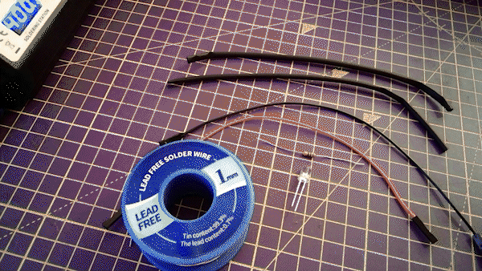
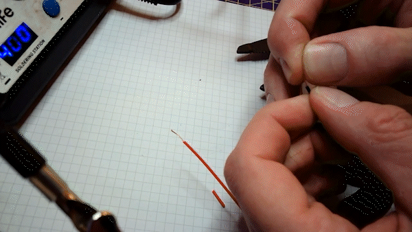
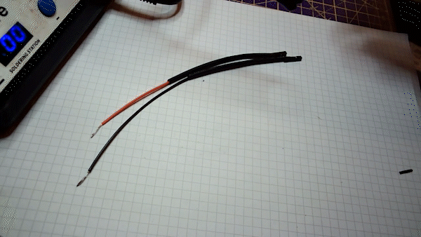
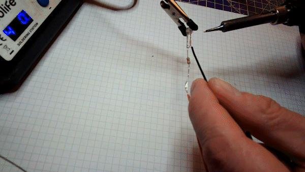
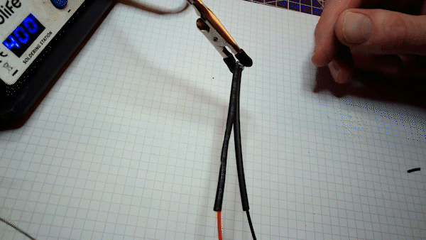

## Cómo soldar un LED, una resistencia y cables puente

- Necesitarás un LED, una resistencia (de 70 ohmios o más), dos cables puente con receptáculos y tubo termocontraíble.

- Calienta una de las patas del LED durante unos segundos y luego aplica soldadura de manera uniforme para estañarla. Repite el proceso con la otra pata.

- Calienta una de las patas de la resistencia durante unos segundos y luego aplica soldadura de manera uniforme para estañarla. Repite el proceso con la otra pata.

- Alinea una pata del LED con una pata de la resistencia y luego aplica calor hasta que se unan.

- Pela dos cables puente de manera que cada uno tenga un extremo con receptáculo.

- Estaña ambos cables puente.

- Coloca un trozo de tubo termocontraíble sobre cada cable puente.

- Suelda un cable puente a la resistencia y el otro a la pata libre del LED.

- Desliza los tubos termocontraíbles hasta cubrir las uniones soldadas.

- Utiliza el borde ancho del soldador para calentar el tubo hasta que quede bien ajustado alrededor de las uniones y los cables de conexión.

- Prueba el LED con un pin 3V3 y un pin GND.

