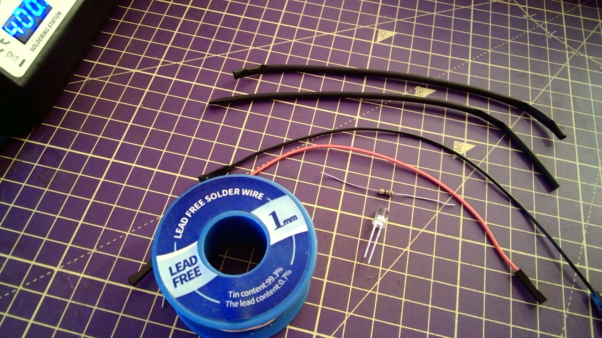
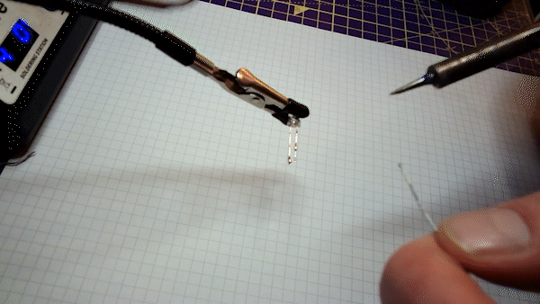
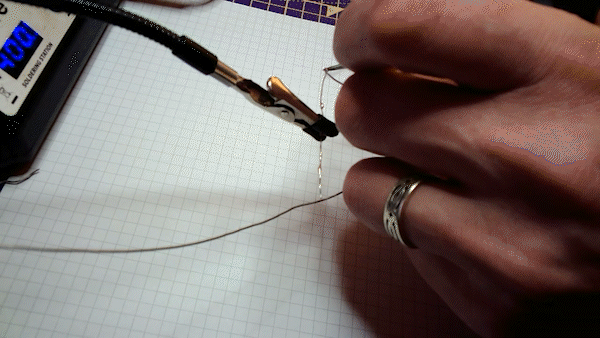
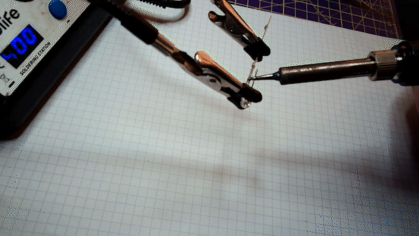
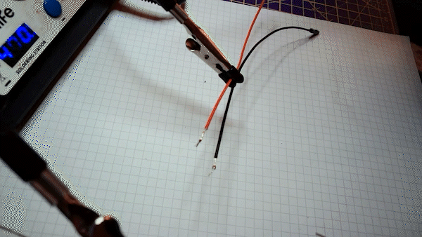
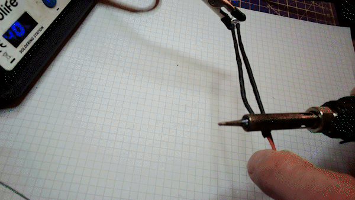

## Cómo soldar un LED, una resistencia y cables de conexión

- Necesitarás un LED, una resistencia (de 70 ohmios o más), dos cables de conexión con conectores hembra y tubo termocontraíble.

- Calienta una de las patas del LED durante unos segundos y luego aplica soldadura de manera uniforme para estañarla. Repite el proceso con la otra pata.

- Calienta una de las patas de la resistencia durante unos segundos y luego aplica soldadura de manera uniforme para estañarla. Repite el proceso con la otra pata.

- Alinea una pata del LED con una pata de la resistencia y luego aplica calor hasta que se unan.

- Pela un extremo de cada cable de conexión y deja el conector hembra en el otro extremo.

- Estaña ambos cables de conexión.

- Coloca un trozo de tubo termocontraíble sobre cada cable de conexión.

- Suelda un cable de conexión a la resistencia y el otro a la pata libre del LED.

- Desliza los tubos termocontraíbles hasta cubrir las uniones soldadas.

- Usa el borde ancho del cautín para calentar los tubos hasta que queden ajustados alrededor de las uniones y los cables de conexión.

- Prueba el LED con un pin 3V3 y un pin GND.

